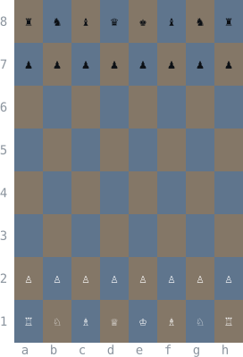

# tokenmate

**Play, watch and analyse chess against any AI model — in your terminal.**

[](LICENSE)

`tokenmate` is a TUI chess game with two separate ideas about "AI" that most chess apps blur together:

- **The opponent is a chess engine.** 20 levels from 300 to 2800 Elo, all of it rule-based search and maths. No
  model, no API key, no network. A level is a level: no "easy", no "hard", no personality names to decode.
- **A model can take a seat — if you bring one.** Point tokenmate at any provider you have a key for, or at a local
  Ollama / LM Studio. The model *sees* the board, reasons about it in the open, and chooses its move from the legal
  moves the engine gives it. It cannot play an illegal move, because it never gets to invent one.

Then you can watch two models play each other, talk, and disagree — or have one explain your own mistakes.

<!-- BOARD:README -->


<sub>The 4×3 board, slate skin, rendered by `bun run board` — the picture in this README comes from the same renderer the app draws with, at the same 32×24 cells.</sub>


## Install

```bash
bunx tokenmate
```

Requires [Bun](https://bun.sh) 1.4 or newer.

### The engine

**tokenmate ships its own chess engine**, so it plays the moment you install it — no Stockfish, no extra step. It is
written in this repo, MIT-licensed like the rest of it: 0x88 board, alpha-beta search with quiescence, material and
piece-square evaluation. Its movegen is verified against the six standard [perft](https://www.chessprogramming.org/Perft_Results)
positions, so it is a real engine rather than a plausible-looking one.

Stockfish (or any UCI engine) is an **optional upgrade**, because a stronger engine plays above the built-in's ceiling
of roughly 1550 Elo. tokenmate does **not** bundle one: engines like Stockfish are GPL-3.0, tokenmate is MIT, and
shipping one inside the package would force the whole project to GPL.

```bash
# Optional — only if you want stronger play than the built-in
brew install stockfish        # macOS
sudo apt install stockfish    # Debian / Ubuntu
choco install stockfish       # Windows (Chocolatey)
```

When one is installed, tokenmate finds it in this order:

1. `--engine <path or command>` — e.g. `--engine /opt/homebrew/bin/stockfish`
2. `$TOKENMATE_ENGINE`
3. `stockfish` on your `PATH`

Anything that speaks UCI works, not just Stockfish. A named engine that fails to start is an error you see, not a
silent switch back to the built-in. Check what you have:

```bash
tokenmate doctor
```

**No engine? The app still runs.** Opening a game, replaying a PGN, importing from Lichess or chess.com and reviewing
positions all work without one. Only playing and live analysis need an engine.

## Play

```bash
tokenmate                                  # level 8 against the engine
tokenmate --level 12                       # the Elo each level plays is printed with it
tokenmate --engine "gnuchess --uci"        # any UCI engine, with arguments
tokenmate --model ollama/qwen3             # a local model takes the seat
tokenmate --spectate --model ollama/qwen3,lmstudio/qwen2.5   # watch two models play
tokenmate replay game.pgn                  # watch a game back, no engine needed
tokenmate doctor                           # what was found: engine, models, cache
```

Controls: arrows or `hjkl` to move, `space` to select and move, `esc` to cancel, `u` to take back, `h` for a hint,
`s` to change skin, `?` for help, `q` to quit.

Each level prints the Elo it actually plays, and that number is honest: levels 1–7 sample among the engine's own
candidate moves because no engine can be told to play below its floor, and `doctor` says so when your build cannot
reach the top of the ladder.

## Bring your own model

Cloud providers come from [models.dev](https://models.dev), re-checked hourly with a conditional request so an
unchanged catalogue costs nothing. Set the provider's usual environment variable — `OPENAI_API_KEY`, `GROQ_API_KEY`,
whatever the provider documents — and pick a model as `provider/model`:

```bash
tokenmate --model openrouter/qwen3-coder          # or groq/…, deepseek/…, openai/…
```

The transport is OpenAI-compatible, so providers with their own protocol are refused by name rather than half-working:
Anthropic's `/v1/messages` is not that shape (use OpenRouter, which fronts it).

Local models are discovered from the server you are running, because models.dev does not carry them:

| server | default endpoint |
| --- | --- |
| Ollama | `http://localhost:11434` |
| LM Studio | `http://localhost:1234` |

### What the model actually sees

The model is never asked to remember a position. Every turn it receives the FEN, this ASCII board, and the exact list of
legal moves — all generated by tokenmate:

```text
8 r n b q k b n r
7 p p p p p p p p
6 . . . . . . . .
5 . . . . . . . .
4 . . . . N . . .
3 . . . . . . . .
2 P P P P P P P P
1 R N B Q K B N R
  a b c d e f g h
```

Upper case is white, lower case is black, so "the knight on c4" is unambiguous. Its reply counts only if it names one of
the moves **we** listed; anything else is retried once and then the engine plays that move instead. A model cannot
invent a piece, a square, or a move.

## Import

```bash
tokenmate import chesscom magnuscarlsen --limit 5
tokenmate import lichess DrNykterstein --limit 5
tokenmate replay <the file it printed>
```

chess.com public archives need no key, and its analysed games carry the accuracy figures it already computed. Lichess
is asked with a descriptive `User-Agent` because the endpoint answers `404` without one. Importing is parsing only, so
it works with no engine installed.

## Documentation

- [docs/PLAN.md](docs/PLAN.md) — the end goal, architecture and phases
- [docs/TODO.md](docs/TODO.md) — what is done and what is next
- [docs/CHANGELOG.md](docs/CHANGELOG.md) — what shipped, per release
- [docs/ARCHITECTURE.md](docs/ARCHITECTURE.md) — modules and invariants

## Contributing

Contributions and issues are welcome. Read [CONTRIBUTING.md](CONTRIBUTING.md) first — there is one rule about keeping
the docs in sync, and it is the only thing we are strict about.

## Licence

MIT. See [LICENSE](LICENSE).

tokenmate contains no GPL code. The chess engine is a runtime dependency you install yourself, and the build fails if a
copyleft package ever enters the dependency tree — `bun run check:licences`.

Design notes and rendered boards: [`relics/tokenmate-design/index.html`](relics/tokenmate-design/index.html).
